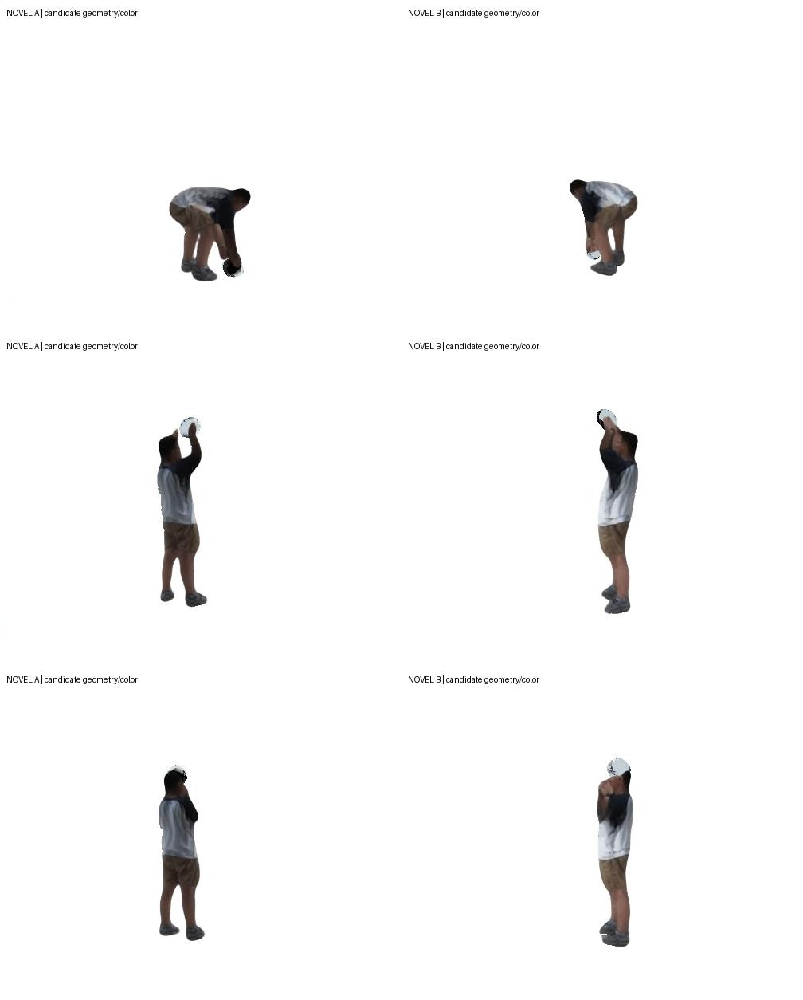

<!-- optimization-20261017 -->
**最新优化进度：** 已生成带原图烘焙头盔颜色和拟合手指动作的完整300帧候选视频，使用逐高斯中心深度裁剪；人体已蒸馏到原SMPL-X拓扑与官方UV，并实际完成Blender静态GLB导出回读。几何、接触和外观仍存在明显局限，严格留出相机评估及背包重建尚未完成。

- [按更正后三张图推进的当前进度](docs/OPTIMIZATION_PROGRESS.md)
- [完整300帧彩色候选视频](media/helmet_full300_color_candidate.mp4)
- [机器可读优化证据](evidence/optimization_milestone.json)

下面136帧内容保留为历史基线；其限制描述以对应历史版本为准。

# 八视角人—物动态重建：阶段研究归档

本仓库记录在八台固定相机上组合人体先验、神经高斯外观与刚体物体估计的实际实验。当前已生成“弯腰拿起头盔—抬起检视—转动头盔”的 **136 个连续采样帧**、两个新视角视频；这是存在明显缺陷的阶段原型。

**完整 CARI4D 官方流水线、头盔完整300帧、背包场景、物理接触及普通软件中的纹理人体资产均未完成。** CoCoNet 已在真实项目输入上运行，但当前适配未改善输入一致性，未用于这里的最终动画。

- [目前进度总结](docs/PROGRESS_20261017.md)
- [复现入口与明确限制](docs/REPRODUCIBILITY.md)
- [来源与许可说明](docs/THIRD_PARTY_NOTICES.md)
- [机器可读阶段证据](evidence/stage_summary.json)

## 阶段视频

以下画面只含生成的新视角，不包含原始拍摄画面。人体保留冻结神经外观，头盔采用**中性灰材质与合成头灯**，用于检查几何和轨迹；灰色不是恢复的真实头盔材质。

- [原速，136帧 / 30fps / 约4.53秒](media/pickup_inspection_novel_30fps.mp4)
- [放慢三倍，同136帧 / 10fps / 13.6秒](media/pickup_inspection_novel_slow10fps.mp4)
- [未验收的颜色投影尝试：可见斑驳与穿插](media/pickup_inspection_color_attempt_30fps.mp4)

放慢展示不增加或插值帧。两个新视角固定相机跨越整个动作；渲染接口支持另给明确K/W。当前没有中间视角真值，视频不能证明新视角重建精度。

## 仓库内容

`research/` 是可审查的实验脚本快照，仍含特定片段、目录和锚点假设；`evidence/` 保存输入拟合、跨视角诊断及独立重放证据；`environment/` 记录上游版本和权重来源。它不是克隆后即可重现私有实验的完整产品。

原始视频、人体模型文件、权重、环境、神经人体资产、完整拟合张量和本机日志未上传。没有原始数据及相应许可资产时，第三方只能核验公开文件和研究逻辑，不能宣称已独立重现该真人结果。

本快照面向非商业研究记录。第三方组件、模型及衍生使用遵循各自上游条款；本仓库不重新许可第三方资产，也未给自有部分额外授予统一开源许可。
