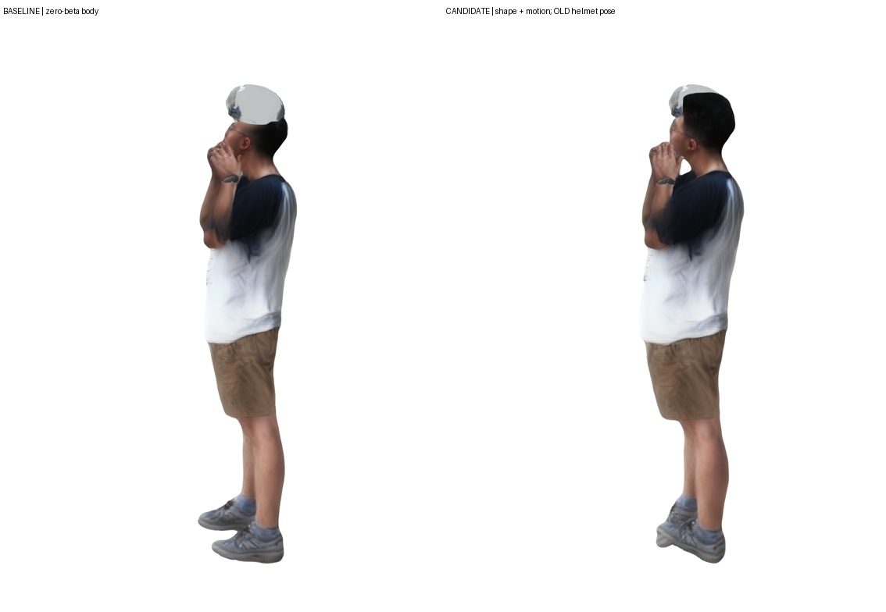
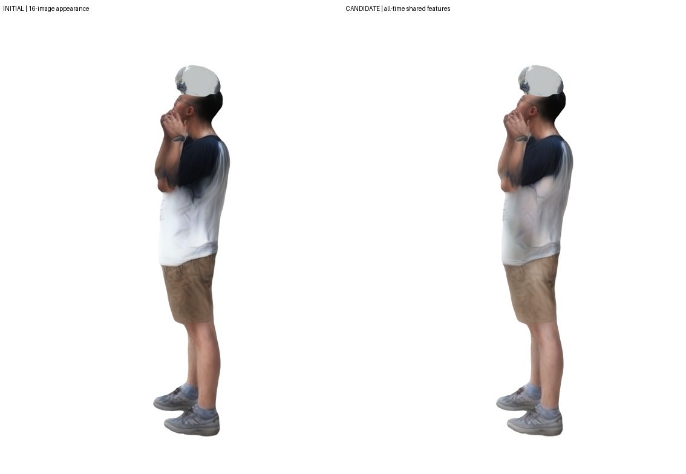
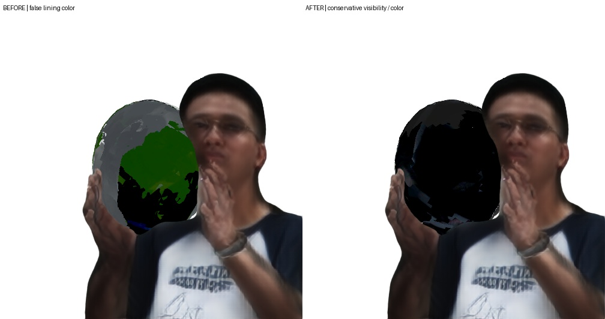
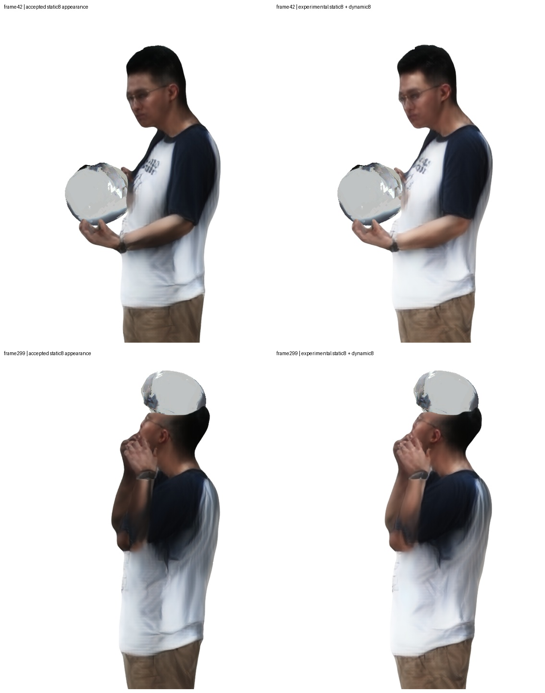
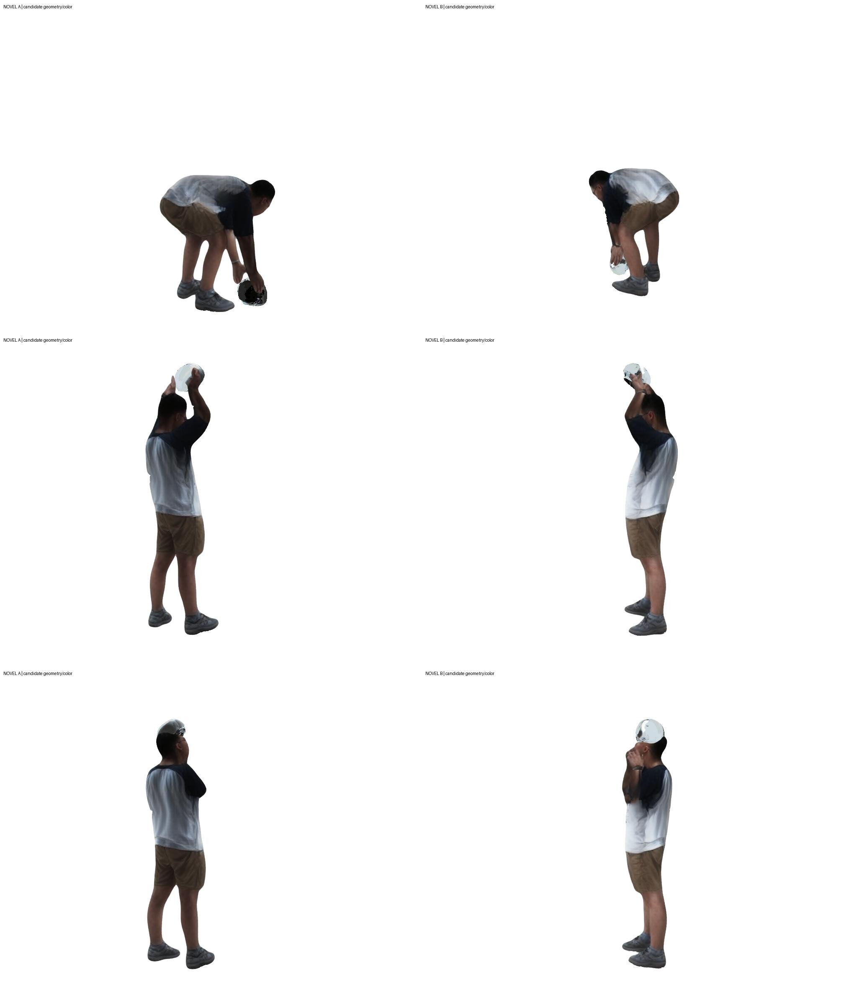
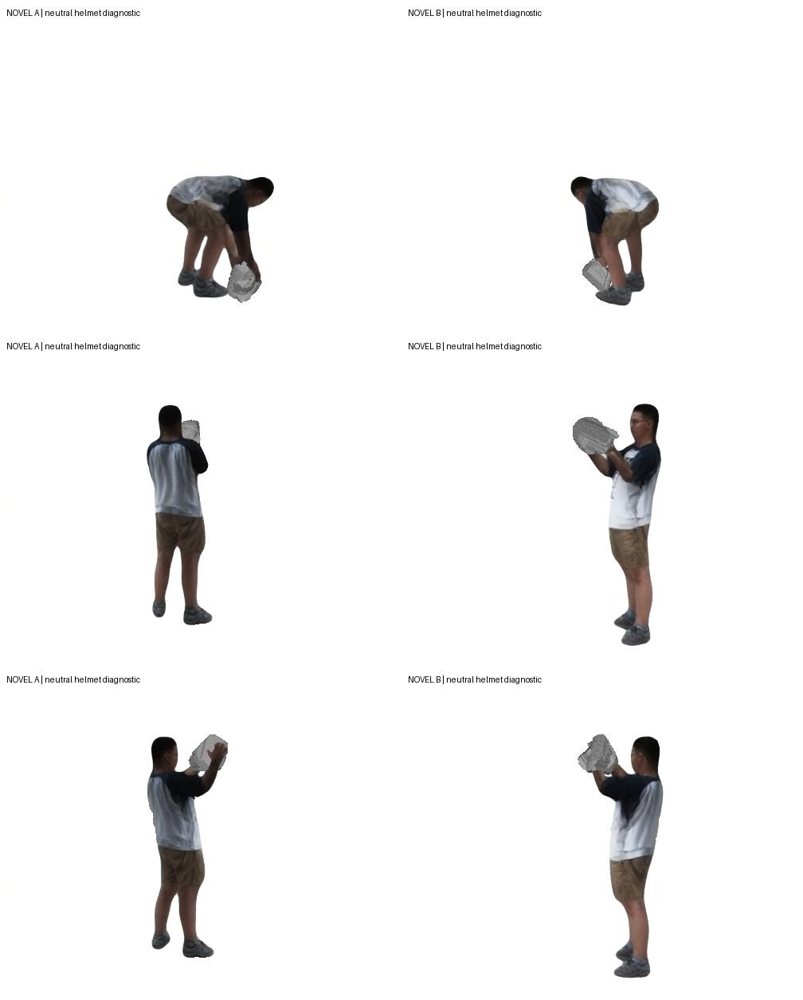

## 2026-10-18 共享体型贯通实际LHM动画

新增共享beta/尺度与300帧动作的联合拟合，并跑相同拟合器的零beta对照。身体输入重投影误差约11.47px，对照约11.88px（1024宽图像）；不同初始化与先验仍影响结果，不能视为真实体型精度。非零体型通过LHM原生零姿态形变及对应骨架导出，抽查3帧的高斯位置与上游一致。

**候选未采用：原头盔位姿尚未跟随新头部重拟合，组合预览明显不对齐。** 基于当前三维对应点的相机颜色校正也因一致性不足被拒绝。

- [验证、零体型对照及失败记录](evidence/shared_shape_20261018.json)

---

## 2026-10-18 全量共享人体特征细化候选

全部8机位×300帧参与同一套LHM外观特征更新，完成300次累计八视角梯度更新，动作/几何/神经解码器保持固定。全量同支持比较中7个机位颜色误差下降，717机位小幅恶化；支持保留约99.2%–99.9%。**候选未采用：侧躯干暗影减少，但颜色变浅、层次变平，手臂拖影和头盔偏浅仍在。** 输入误差不是新视角真值。

- [逐机位证据及限制](evidence/shared_features_20261018.json)
- [仅42/180/299三帧预览，非连续动作视频](media/shared_feature_three_frame_preview.mp4)

---

## 2026-10-18 全量人体观测比较

已用同一共享人体模型比较全部8机位×300帧，保存后续外观拟合的固定初始支持区域，排除候选头盔遮挡，并逐帧记录覆盖与颜色残差。全部2400条达到最低128像素支持要求；这不是观测准确性验收。**尚未据此更新人体外观，不能宣称画面质量已提升。**

- [各机位覆盖及残差汇总](evidence/shared_human_observations_20261018.json)

---

## 2026-10-18 统一共享场景结构

人体规范外观/体型、头盔几何/UV贴图与逐帧动作/位姿分开保存。新加载接口在3帧、8个真实方向及2个新方向共30张图上与原接口逐像素一致。**这是结构与复现验证，尚未完成全量图像的联合优化。**

完整300帧颜色位姿实验中，颜色误差下降但轮廓IoU下降，未采用；后续应在共享场景上交替更新观测选择、动作位姿与共享资产。

- [共享模型与全量观测优化设计](docs/SHARED_SCENE_DESIGN.md)
- [本阶段验证与未采用实验](evidence/shared_scene_20261018.json)

---

## 2026-10-18 头盔内衬与可见性修正

修正了外壳/内衬混用选帧、人体深度未知区误当空背景，以及暗部校色产生绿斑的问题。生成近景中的绿色污染减少；观测UV覆盖下降，补色区域仍显式标记。**头盔佩戴仍偏浅，未验收，不替换已认可人体。** 体型条件试验平均仅改善约0.22px，未据此采用新体型。

- [本阶段结果与限制](docs/HELMET_FOLLOWUP_20261018.md)
- [机器可读证据](evidence/helmet_followup_20261018.json)

---

<!-- milestone-20261018 -->
## 2026-10-18 阶段候选：多姿态LHM++与竖屏完整动作

新增8张动态人体裁剪，与原8张静态图联合生成LHM++外观候选，保留原高斯/神经渲染路线和已认可版本。完整300帧以1134×1512每新视角输出，附慢速版。头盔试用实际LHM保守遮挡缓存、收紧佩戴附着与跨相机颜色一致性选帧。**头盔仍偏浅，候选未全面验收，不能据输入拟合或补色后的干净画面宣称真实重建质量。** 新检视开口壳体尚未加入此视频。网格资产后置。

- [新完整300帧视频](media/multitime16_portrait_full300.mp4)
- [10fps慢速版](media/multitime16_portrait_full300_slow10fps.mp4)
- [本阶段进度及未完成项](docs/PROGRESS_20261018.md)
- [机器可读阶段证据](evidence/milestone_20261018.json)

左为已认可静态8图外观，右为16图候选；动作、相机和头盔保持相同。真实八机位并排图含原始照片，仅留本地；这里仅发布生成画面。

---

<!-- optimization-20261017 -->
**当前视频继续使用原始LHM++高斯人体和神经渲染器。** 已逐张量确认人体外观与原方案完全一致；网格资产支线因外观质量不足暂缓，没有替换视频人体。最新完整300帧候选加入八视角面部约束的头颈动作、拟合手指、原图头盔UV颜色和逐高斯中心裁剪；固定新视角输出1008×756。头盔开口、纹理污染与真实接触仍未验收，严格留出评估和背包重建仍未完成。

- [按更正后三张图推进的当前进度](docs/OPTIMIZATION_PROGRESS.md)
- [完整300帧LHM++候选视频](media/helmet_full300_lhm_head_candidate.mp4)
- [完整300帧慢速版（10fps）](media/helmet_full300_lhm_head_candidate_slow10fps.mp4)
- [同外观、同机位的头部姿态前后对照](media/lhm_head_pose_comparison.jpg)
- [原LHM++人体外观保持证据](evidence/lhm_body_preservation.json)
- [机器可读优化证据](evidence/optimization_milestone.json)

下面136帧内容保留为历史基线；其限制描述以对应历史版本为准。

# 八视角人—物动态重建：阶段研究归档

本仓库记录在八台固定相机上组合人体先验、神经高斯外观与刚体物体估计的实际实验。当前已生成“弯腰拿起头盔—抬起检视—转动头盔”的 **136 个连续采样帧**、两个新视角视频；这是存在明显缺陷的阶段原型。

**完整 CARI4D 官方流水线、头盔完整300帧、背包场景、物理接触及普通软件中的纹理人体资产均未完成。** CoCoNet 已在真实项目输入上运行，但当前适配未改善输入一致性，未用于这里的最终动画。

- [目前进度总结](docs/PROGRESS_20261017.md)
- [复现入口与明确限制](docs/REPRODUCIBILITY.md)
- [来源与许可说明](docs/THIRD_PARTY_NOTICES.md)
- [机器可读阶段证据](evidence/stage_summary.json)

## 阶段视频

以下画面只含生成的新视角，不包含原始拍摄画面。人体保留冻结神经外观，头盔采用**中性灰材质与合成头灯**，用于检查几何和轨迹；灰色不是恢复的真实头盔材质。

- [原速，136帧 / 30fps / 约4.53秒](media/pickup_inspection_novel_30fps.mp4)
- [放慢三倍，同136帧 / 10fps / 13.6秒](media/pickup_inspection_novel_slow10fps.mp4)
- [未验收的颜色投影尝试：可见斑驳与穿插](media/pickup_inspection_color_attempt_30fps.mp4)

放慢展示不增加或插值帧。两个新视角固定相机跨越整个动作；渲染接口支持另给明确K/W。当前没有中间视角真值，视频不能证明新视角重建精度。

## 仓库内容

`research/` 是可审查的实验脚本快照，仍含特定片段、目录和锚点假设；`evidence/` 保存输入拟合、跨视角诊断及独立重放证据；`environment/` 记录上游版本和权重来源。它不是克隆后即可重现私有实验的完整产品。

原始视频、人体模型文件、权重、环境、神经人体资产、完整拟合张量和本机日志未上传。没有原始数据及相应许可资产时，第三方只能核验公开文件和研究逻辑，不能宣称已独立重现该真人结果。

本快照面向非商业研究记录。第三方组件、模型及衍生使用遵循各自上游条款；本仓库不重新许可第三方资产，也未给自有部分额外授予统一开源许可。
