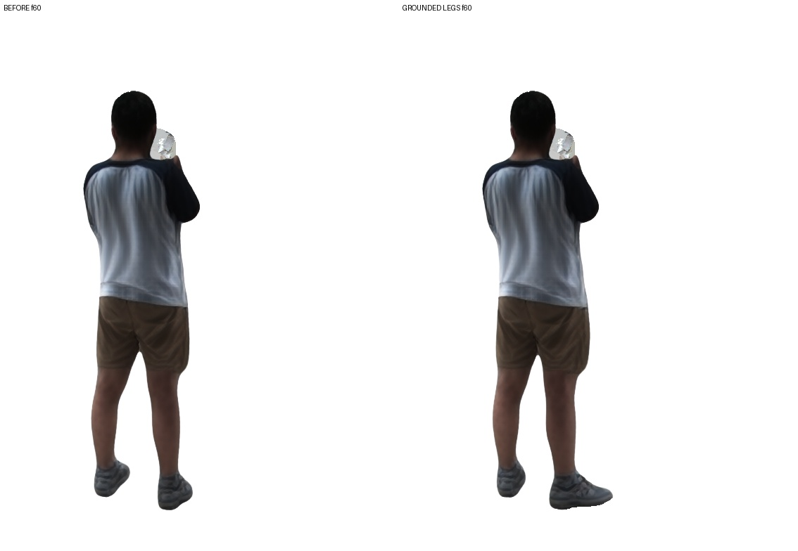
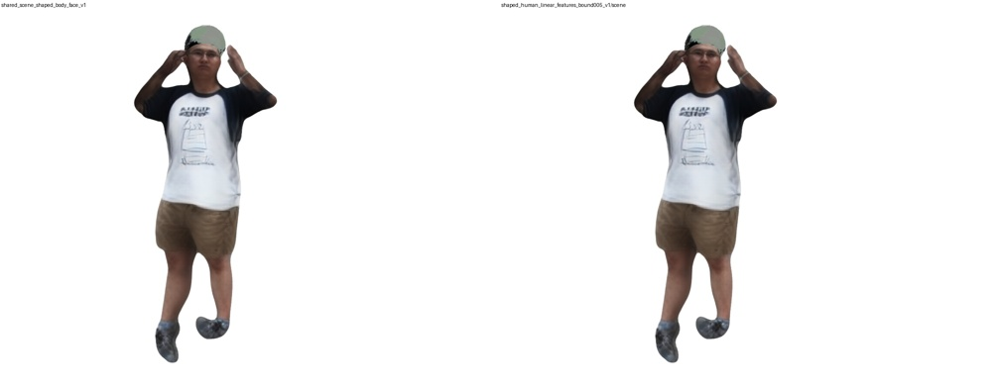
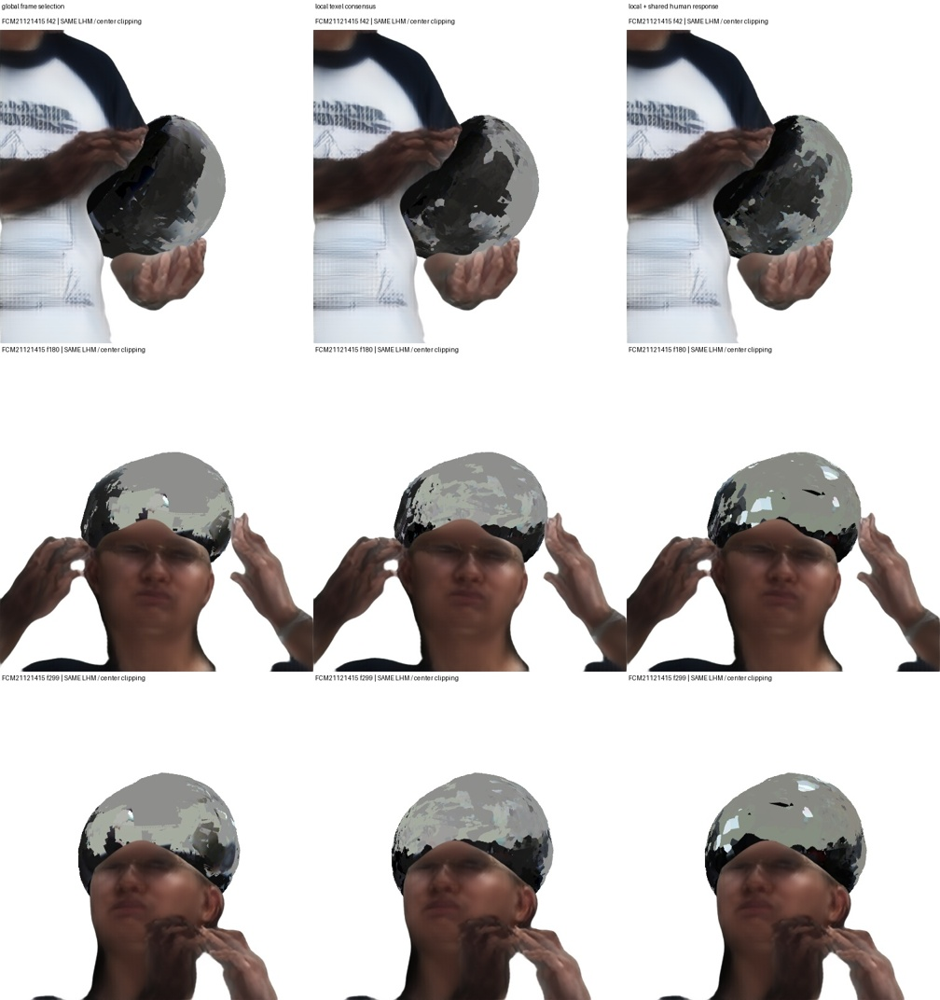
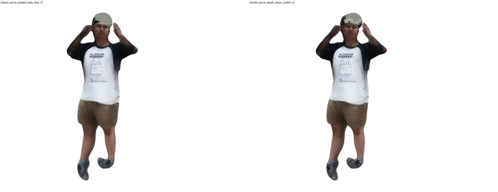
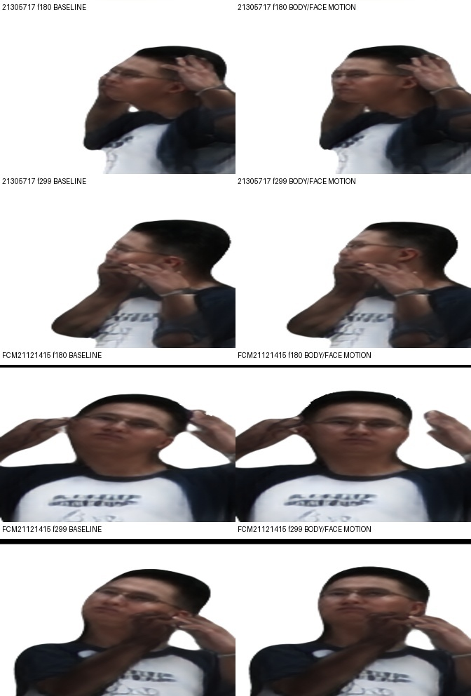
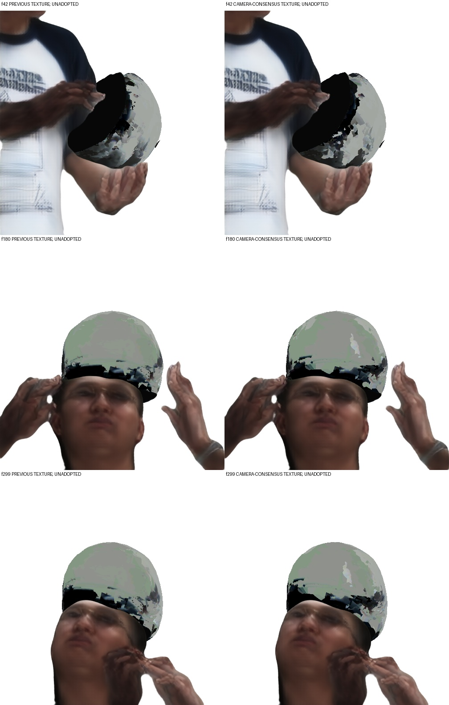
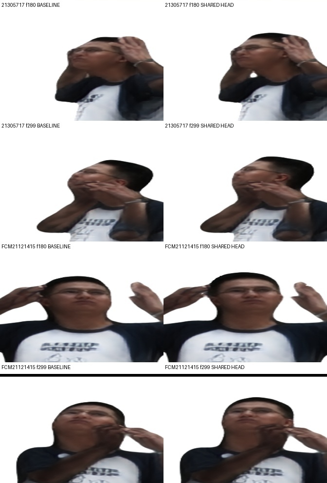
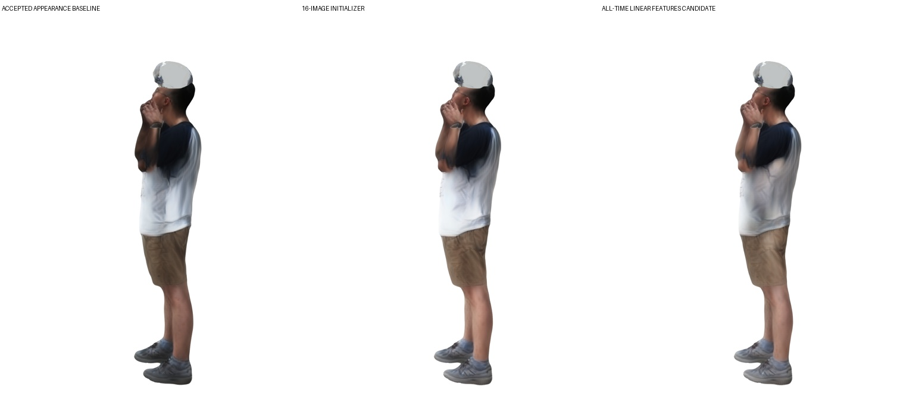

## 举臂与抬肘多时刻外观阶段

本阶段保留原静态八图，补入第160帧举臂、第225帧抬肘的八机位原分辨率人体裁剪，16张输入共同生成一套LHM++规范外观。动态补充图的头部与头盔区域排除，头部外观主要由原无遮挡静态输入提供。

第一次输入仅扣除头盔掩码，实际渲染出现头发白斑，未采用；修正输入区域后重做编码、融合、导出和跨阶段渲染。已验证新外观所用的完整300帧动作、腿脚改善及预训练神经渲染器与对照版精确一致；头盔沿用原资产和位姿，本阶段没有优化头盔。

完成20个跨阶段时刻、八个真实方向和两个新方向的前后对照。以下视频每个关键帧停留一秒，便于检查，**不是连续300帧动作视频**。左侧为原外观，右侧为本阶段候选。

- [新方向A：20个关键帧前后对照](media/overhead_appearance_novel0_keyframes.mp4)
- [新方向B：20个关键帧前后对照](media/overhead_appearance_novel1_keyframes.mp4)
- [举臂时八个真实方向的纯生成对照](media/overhead_appearance_all8_0165_generated.jpg)
- [抬肘时八个真实方向的纯生成对照](media/overhead_appearance_all8_0225_generated.jpg)
- [输入来源、导出回放与实际渲染记录](evidence/overhead_appearance_20261018.json)

观察：修正后的输入消除了第一轮新引入的明显头发白斑；腋下仍有向躯干延伸的深色拖影，补充姿态本身尚未解决它。因此保留此候选用于接下来的可靠观测筛选与细化，原认可版本继续保留，不将编码成功当作最终画质通过。

下一步从全部八机位、300帧中选择对齐可靠的身体区域，排除轮廓边缘、头盔遮挡和过曝像素，再细化同一套规范外观。相关筛选选项已实现，尚未以全序列运行。含原片的输入图、对照页、标定及授权人体模型张量均只保留本地。

---

## 已恢复工作：腿部与足部第一阶段完成

将八机位、300帧已有的大脚趾/小脚趾/脚跟六点接入拟合，加入有效的关节位置与旋转时间平滑，以及从多视角低速足部轨迹识别的着地位置/速度约束。只更新下肢，原认可LHM人体外观、体型、上半身动作和同一头盔资产/轨迹保留。

六点重投影均值约36.4→12.3原图像素。实际神经渲染与视频编码后，在45..95连续51帧的共同固定脚部区域测得：A视角水平位置二阶差分绝对值中位数3.55→0.26像素，B视角1.34→0.18像素；人体高度分别602/598像素。这里测量51帧，不与旧报告45..299范围混用。相同阈值/区域用于前后两版。

- [A视角连续视频：左修复前、右修复后](media/grounded_legs_novel_0_before_after.mp4)
- [B视角连续视频：左修复前、右修复后](media/grounded_legs_novel_1_before_after.mp4)
- [A视角脚部放大动画](media/grounded_legs_camera0_feet.gif)
- [B视角脚部放大动画](media/grounded_legs_camera1_feet.gif)
- [六点筛选、实现校验、300帧拟合、实际渲染与稳定性测量](evidence/grounded_legs_20261018.json)

同时完成跨阶段20帧×八个真实相机的原图/修复前/修复后对照，含原片的对照只留本地。下一步处理佩戴头部姿态、头盔与头发，再补举臂/抬肘外观输入及细化；完整项目尚未结束。以下暂停说明为用户重新开工前的历史记录。

---

## 当前状态：用户要求暂停，阶段代码与结果已归档

2026-10-18停止优化及自动续跑。已完成的对照保留，三个中途停止的实验没有最终模型或轨迹，日志中的训练指标不当作成果；新材料分界开口分支尚未完成端到端验证。

新增完成的稳定抓握搜索用36..47全部12帧、71条有效机位/时间观测共同评价一个共享朝向，4096候选筛选后64模式实际纹理比较仍选择原朝向，没有采用旋转改动。低分辨率全2400观测的人体共享特征细化也已实际对照，变化很小，未采用；更高采样密度版本中途停止。

- [暂停、已完成/未完成结果及恢复边界](research/interaction_20261017/USER_PAUSE_20261018.md)
- [共享朝向搜索与停止时的标量记录](evidence/user_pause_20261018.json)

---

## 局部观测筛选对照：找回被整帧条件排除的内衬证据

逐项审计发现，旧全局条件要求同一帧至少两机位在64个共同表面点上支持颜色一致性，内衬的候选帧因此全部被排除。内衬黑色来自先验填补，不能算重建观测。

保持人体、头盔几何和300帧运动完全相同，改为对同一纹素跨时刻汇集观测，再要求至少两台独立相机的一致颜色支持。内衬约9.4万个纹素获得支持；外壳部分冲突观测被排除。未覆盖或冲突处仍单独标记为未知，后续填补仍是推断。实际渲染的灰斑仍在，候选未采用。

另对照把人体估计的固定相机响应共享给头盔，避免每个资产各自拟合曝光。人体响应也带有模型和照明偏差，因此这只是受控替换；已核验观测/模型增益与烘焙增益的互逆约定。三组同机位诊断见证据，不能据输入误差证明新视角质量。

- [筛选审计、内衬覆盖、响应检查与同机位指标](evidence/local_texture_controls_20261018.json)

---

## 共享模型交替拟合：先修正遮挡评分，再比较候选

目标结构是少量跨帧共享资产（人体外观/体型、头盔形状/UV/贴图），加逐帧运动。全八机位与全时刻观测经可靠性筛选进入交替更新，信息不足处才补先验。具体变量与执行边界见 [共享模型方案](research/interaction_20261017/SHARED_MODEL_PLAN.md)。

修正一项评分解释：历史“面部覆盖”实际是二维网格投影，网格在脸后也会计入，不能解释为真实遮挡。现在只在可靠人体深度存在且网格更靠前时计入，缺深度仍未知；历史计算可用 `--legacy-raw-face-coverage` 复现。这次只有490/1309个面部点具有深度支持，不能凭零前向覆盖宣称无遮挡。

新几何→80步位姿→UV→原图纹理一轮完成。42/180/299三帧、八个输入机位同支持比较：可见头盔IoU约0.654→0.677，前景SSIM约0.334→0.332，PSNR约8.791→8.797dB。相机响应未另行拟合；这些是输入诊断，且不同于拟合时低分辨率软IoU。贴图灰斑仍明显，候选未采用。

- [完整阶段证据与解释修正](evidence/depth_aware_alternation_20261018.json)

---

## 同一体型与外观下，身体和面部动作一起拟合

将数据估计的非零体型接入原认可8图LHM外观后，发现只看躯干与手的动作目标会丢失面部对齐。现在固定同一套规范人体、体型、尺度与手指动作，让躯干、手部和真实LHM语义面部锚点共同约束根部/脊柱/头颈运动。

同初始化的零面部项对照，最终面部输入误差约41.6原图像素；联合项约10.1，身体/手部指标接近。重新渲染并重新检测的抽查中，未佩戴段12点约24.0→17.1像素、佩戴段18点约17.6→12.5像素。样本少、无独立新视角真值，尚未采用；新动作下的头盔需要继续重拟合。非零体型参数也未获得物理体型精度认证。

- [动作控制、实际渲染与未解决项](evidence/body_face_20261018.json)

头盔另测试了9个共享耳侧/后缘开口高度组合，零参数精确重建旧模型，全部壳体通过拓扑检查；在当前固定动作下仍选择零延伸，因此没有把这项形状先验当作改善结果。

---

## 更新共享人体后的完整300帧场景与纹素可靠性检查

共享头部修正后，重新渲染全8机位300帧的人体可见性，再联合更新佩戴段头颈与头盔。面部输入误差15.41→13.83原图像素，轮廓IoU约0.8669→0.8600；仍有头盔偏浅与黑斑，未采用。新共享场景的正常/慢放视频均独立解码300帧，保留原认可外观特征。

- [完整300帧纯生成候选，30fps](media/shared_head_scene_all300_30fps.mp4)
- [慢放，10fps](media/shared_head_scene_all300_slow10fps.mp4)
- [分块结果与未解决项](evidence/outer_scene_20261018.json)

纹素级跨相机一致性现在可以排除单机位主导和互相矛盾的颜色；真实数据可信UV覆盖约51%→35%，黑斑仍在，不能将更多填充当成改善。可选的手部点接触项也已验证，但原候选106个手持帧已经满足宽松的一点邻近条件，这不足以解决穿插；非穿透仍未完成。背包机位编号穷举检查未找到可用替代对应。两个检视时刻的头盔图像特征也未形成通过严格筛选的三视图点，暂不据此拟合新几何。

---

## 共享头部修正：从代理残差走到实际画面复测

固定全部300帧动作，用未佩戴阶段的可靠面部观测估计一个共享规范头部修正，并实际改变高斯中心与朝向。之后重新渲染，用同一检测器、同一裁剪框比较原片与前后生成图，避免只验证拟合代理自身。抽查佩戴段的16个有效面部点，实际渲染检测误差约19.42→14.43原图像素；未佩戴抽查10点约13.05→13.02，没有明显改善。样本少，头盔问题仍在，未替换认可基线。

修正后的72个规范视角已重新提取语义锚点，并绑定规范模型张量身份；实测拒绝旧模型锚点，更新后的拟合梯度有效。共享几何改变后，需要重算全部时间的可见性，再继续动作/头盔更新；不能沿用旧人体深度。

- [共享修正、实际渲染复测与身份检查](evidence/shared_head_20261018.json)

---

## 共享模型分块验证：未通过的头盔候选与独立背包演员

按同一共享场景继续几何、贴图与位姿的分块更新。12个共享开口候选中，评分选出的方案减少面部遮盖却降低轮廓一致性，暂不采用。固定RGB比较支持的全序列位姿试验同样出现颜色误差下降、轮廓下降，因此未替换已有结果。更新位姿后的原图UV重烘焙仍有黑斑，实际近景复核也显示头部仰角不对；下一块转向实际LHM面部锚点与朝向可见性，而非只靠旧代理点降低数字。

背包场景的另一位演员已从10张独立裁剪输入生成规范LHM外观，并完成72视角渲染和上游动画导出一致性检查。目前只完成演员初始化；显示A姿态不是重建动作，背包非刚性重建及该场景相机对应仍未解决。

- [共享模型试验与明确边界](evidence/shared_models_20261018.json)
- [独立演员规范视角视频，24帧；非序列动作](media/backpack_actor_canonical_turntable.mp4)
- [72个规范虚拟视角](media/backpack_actor_canonical72.jpg)
- [未采用的重烘焙近景，仅生成图](media/helmet_rebake_unadopted.jpg)

---

## 同一共享场景的完整300帧联合运动候选

保留此前认可LHM规范高斯、特征和神经解码器，仅更新佩戴段头颈与头盔运动，已组装为共享资产/逐帧状态分离的同一场景，并独立渲染完整300帧。张量核对确认其他人体动作及佩戴前动作保持一致。头盔偏浅、贴图和真实接触仍未解决，**此视频是未验收候选，不是最终结果**。

- [完整共享场景候选，30fps](media/shared_joint_scene_all300_30fps.mp4)
- [慢放，10fps](media/shared_joint_scene_all300_slow10fps.mp4)

头盔RGB拟合另修正了“丢失可比较像素却降低平均误差”的漏洞；真实离屏反例现在产生缺失惩罚而非零误差。该验证不代表位姿画质提升。

---

## 2026-10-18 参考颜色空间细化与头部—头盔联合更新

固定717机位为颜色参考，在线性光空间用全2400张图细化同一套LHM特征，八机位同协议输入误差均下降；已独立渲染并逐帧解码验证300帧新视角候选。颜色仍偏浅，尚未替换原认可人体；此指标与旧sRGB误差不可直接比较，也不代表新视角真值。

佩戴段头颈与头盔共享附着变换现可共同更新；首轮之后重算真实LHM深度与阶段锚点，再完成第二轮。面部输入误差约25.99→25.03→24.46px，轮廓指标小幅变化；头盔仍偏浅、贴图不稳定，未验收。三角化背包人体时发现多数机位对应不能被当前标定解释，暂不把这些误差吸收到体型或软包形变中。

- [完整300帧纯生成候选，30fps](media/shared_linear_features_all300_30fps.mp4)
- [完整300帧慢放，10fps](media/shared_linear_features_all300_slow10fps.mp4)
- [联合更新、覆盖与未解决问题](evidence/shared_joint_20261018.json)

---

## 2026-10-18 共享体型贯通实际LHM动画

新增共享beta/尺度与300帧动作的联合拟合，并跑相同拟合器的零beta对照。身体输入重投影误差约11.47px，对照约11.88px（1024宽图像）；不同初始化与先验仍影响结果，不能视为真实体型精度。非零体型通过LHM原生零姿态形变及对应骨架导出，抽查3帧的高斯位置与上游一致。

**候选未采用：原头盔位姿尚未跟随新头部重拟合，组合预览明显不对齐。** 基于当前三维对应点的相机颜色校正也因一致性不足被拒绝。

- [验证、零体型对照及失败记录](evidence/shared_shape_20261018.json)

---

## 2026-10-18 全量共享人体特征细化候选

全部8机位×300帧参与同一套LHM外观特征更新，完成300次累计八视角梯度更新，动作/几何/神经解码器保持固定。全量同支持比较中7个机位颜色误差下降，717机位小幅恶化；支持保留约99.2%–99.9%。**候选未采用：侧躯干暗影减少，但颜色变浅、层次变平，手臂拖影和头盔偏浅仍在。** 输入误差不是新视角真值。

- [逐机位证据及限制](evidence/shared_features_20261018.json)
- [仅42/180/299三帧预览，非连续动作视频](media/shared_feature_three_frame_preview.mp4)

---

## 2026-10-18 全量人体观测比较

已用同一共享人体模型比较全部8机位×300帧，保存后续外观拟合的固定初始支持区域，排除候选头盔遮挡，并逐帧记录覆盖与颜色残差。全部2400条达到最低128像素支持要求；这不是观测准确性验收。**尚未据此更新人体外观，不能宣称画面质量已提升。**

- [各机位覆盖及残差汇总](evidence/shared_human_observations_20261018.json)

---

## 2026-10-18 统一共享场景结构

人体规范外观/体型、头盔几何/UV贴图与逐帧动作/位姿分开保存。新加载接口在3帧、8个真实方向及2个新方向共30张图上与原接口逐像素一致。**这是结构与复现验证，尚未完成全量图像的联合优化。**

完整300帧颜色位姿实验中，颜色误差下降但轮廓IoU下降，未采用；后续应在共享场景上交替更新观测选择、动作位姿与共享资产。

- [共享模型与全量观测优化设计](docs/SHARED_SCENE_DESIGN.md)
- [本阶段验证与未采用实验](evidence/shared_scene_20261018.json)

---

## 2026-10-18 头盔内衬与可见性修正

修正了外壳/内衬混用选帧、人体深度未知区误当空背景，以及暗部校色产生绿斑的问题。生成近景中的绿色污染减少；观测UV覆盖下降，补色区域仍显式标记。**头盔佩戴仍偏浅，未验收，不替换已认可人体。** 体型条件试验平均仅改善约0.22px，未据此采用新体型。

- [本阶段结果与限制](docs/HELMET_FOLLOWUP_20261018.md)
- [机器可读证据](evidence/helmet_followup_20261018.json)

---

<!-- milestone-20261018 -->
## 2026-10-18 阶段候选：多姿态LHM++与竖屏完整动作

新增8张动态人体裁剪，与原8张静态图联合生成LHM++外观候选，保留原高斯/神经渲染路线和已认可版本。完整300帧以1134×1512每新视角输出，附慢速版。头盔试用实际LHM保守遮挡缓存、收紧佩戴附着与跨相机颜色一致性选帧。**头盔仍偏浅，候选未全面验收，不能据输入拟合或补色后的干净画面宣称真实重建质量。** 新检视开口壳体尚未加入此视频。网格资产后置。

- [新完整300帧视频](media/multitime16_portrait_full300.mp4)
- [10fps慢速版](media/multitime16_portrait_full300_slow10fps.mp4)
- [本阶段进度及未完成项](docs/PROGRESS_20261018.md)
- [机器可读阶段证据](evidence/milestone_20261018.json)

左为已认可静态8图外观，右为16图候选；动作、相机和头盔保持相同。真实八机位并排图含原始照片，仅留本地；这里仅发布生成画面。

---

<!-- optimization-20261017 -->
**当前视频继续使用原始LHM++高斯人体和神经渲染器。** 已逐张量确认人体外观与原方案完全一致；网格资产支线因外观质量不足暂缓，没有替换视频人体。最新完整300帧候选加入八视角面部约束的头颈动作、拟合手指、原图头盔UV颜色和逐高斯中心裁剪；固定新视角输出1008×756。头盔开口、纹理污染与真实接触仍未验收，严格留出评估和背包重建仍未完成。

- [按更正后三张图推进的当前进度](docs/OPTIMIZATION_PROGRESS.md)
- [完整300帧LHM++候选视频](media/helmet_full300_lhm_head_candidate.mp4)
- [完整300帧慢速版（10fps）](media/helmet_full300_lhm_head_candidate_slow10fps.mp4)
- [同外观、同机位的头部姿态前后对照](media/lhm_head_pose_comparison.jpg)
- [原LHM++人体外观保持证据](evidence/lhm_body_preservation.json)
- [机器可读优化证据](evidence/optimization_milestone.json)

下面136帧内容保留为历史基线；其限制描述以对应历史版本为准。

# 八视角人—物动态重建：阶段研究归档

本仓库记录在八台固定相机上组合人体先验、神经高斯外观与刚体物体估计的实际实验。当前已生成“弯腰拿起头盔—抬起检视—转动头盔”的 **136 个连续采样帧**、两个新视角视频；这是存在明显缺陷的阶段原型。

**完整 CARI4D 官方流水线、头盔完整300帧、背包场景、物理接触及普通软件中的纹理人体资产均未完成。** CoCoNet 已在真实项目输入上运行，但当前适配未改善输入一致性，未用于这里的最终动画。

- [目前进度总结](docs/PROGRESS_20261017.md)
- [复现入口与明确限制](docs/REPRODUCIBILITY.md)
- [来源与许可说明](docs/THIRD_PARTY_NOTICES.md)
- [机器可读阶段证据](evidence/stage_summary.json)

## 阶段视频

以下画面只含生成的新视角，不包含原始拍摄画面。人体保留冻结神经外观，头盔采用**中性灰材质与合成头灯**，用于检查几何和轨迹；灰色不是恢复的真实头盔材质。

- [原速，136帧 / 30fps / 约4.53秒](media/pickup_inspection_novel_30fps.mp4)
- [放慢三倍，同136帧 / 10fps / 13.6秒](media/pickup_inspection_novel_slow10fps.mp4)
- [未验收的颜色投影尝试：可见斑驳与穿插](media/pickup_inspection_color_attempt_30fps.mp4)

放慢展示不增加或插值帧。两个新视角固定相机跨越整个动作；渲染接口支持另给明确K/W。当前没有中间视角真值，视频不能证明新视角重建精度。

## 仓库内容

`research/` 是可审查的实验脚本快照，仍含特定片段、目录和锚点假设；`evidence/` 保存输入拟合、跨视角诊断及独立重放证据；`environment/` 记录上游版本和权重来源。它不是克隆后即可重现私有实验的完整产品。

原始视频、人体模型文件、权重、环境、神经人体资产、完整拟合张量和本机日志未上传。没有原始数据及相应许可资产时，第三方只能核验公开文件和研究逻辑，不能宣称已独立重现该真人结果。

本快照面向非商业研究记录。第三方组件、模型及衍生使用遵循各自上游条款；本仓库不重新许可第三方资产，也未给自有部分额外授予统一开源许可。
