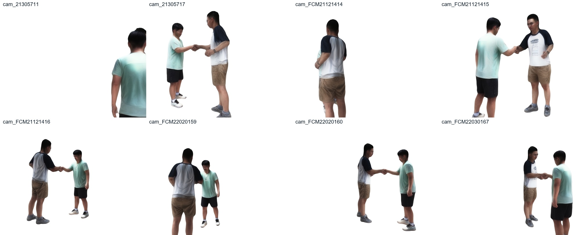

# 双人交互与衣物动态进展（2026-11-03）

本次发布在已发布的 FCS 单人体与头盔结果上增加双人重建和衣物动态训练代码。

## 双人交互

FCS008 使用全部八相机、300 个时刻、30fps。先在各机位首帧标记两个身份，再通过 SAM2 实例传播与每人独立检测获得观测；同身份跨视角三角化，两人共享 FCS006 世界坐标，各自保留身份资产和人体尺度。

当前入口是 `work/mjj/two_person/pipeline_adapter.py reconstruct`，具体参数见同目录 `STATUS.md`。顺序执行身体/脚/手、头颈脸点、最终 MAP；内部保存归一化四元数，以相对旋转的 Log 表达时间约束。最终阶段以已拟合轨迹为中心，保留身体时序项并覆盖手指，修正此前阶段切换重新追逐含噪初值造成的抽动。HaMeR 多视图观测只提供局部手指旋转，经 SO(3) 融合与 OAS 切空间似然进入手部拟合。

已生成并检查完整正面视频及八机位七时刻。抓握形态和稳定性改善，握手接触、脸手外观及软包仍未解决。下面视频是当前渲染，未包含原始拍摄画面。

[完整双人重建视频](../../media/two_person_interaction_current.mp4)

## 衣物动态

使用 Animatable Gaussians 训练出的衣物模板，接入 GaussianWardrobe 的身体/衣物分层网络。现已准备真实八机位 × 99 时刻（9fps）的 RGB、实例 mask、人体先验 mask、上下装语义、beta/zero-shape 权重体积和逐层规范位置图。修正语义 palette 与作者渲染器不一致，以及背面属性图翻转但面编号未同步翻转的问题。

运行入口在 `cloth_dynamics/wardrobe/integration.py`：`--pretrain` → `--train --updates 1000` → `--render --frames 0 49 98 --video --video-camera 4`，均从 wardrobe 目录执行。滚动检查点同时保存模型、原生 Adam 状态、随机状态与数据游标；CPU 状态和 UNet 重计算用于适应本机显存。图像训练后输出八机位与完整 99 时刻视频。发布时仍处于预训练阶段，尚无通过实际视频审看的动态衣物结果。模板训练完成不能代表动态重建完成。

## 运行环境与外部输入

仓库提供项目代码、配置、必要的历史观测模块和当前生成的视频；原始视频/照片、标定和观测数值包、模型及权重、训练检查点均在本地。

保留既有 LHM++ 安装于 `lhmpp/`，其模型/依赖布局与 `docs/BASELINE.md` 一致。`environment/mjj_runtime/` 保存项目自有的三个运行适配文件；新机器将它们放到本地 `lhmpp/` 下。基础依赖包括 PyTorch/CUDA、NumPy、OpenCV、SciPy、PyTorch3D、gsplat、LHM++ 和本地 SMPL-X、SAM2、RTMW、NLF、HaMeR 权重。外部依赖仍按各自许可获取。

衣物上游源码独立获取，不在本次发布中再分发：

- AnimatableGaussians: https://github.com/lizhe00/AnimatableGaussians ，固定 `2b0f6e3b4c5af823414eb6d5f0b2e1a59954d114`，放到 `work/mjj/cloth_dynamics/author`。
- GaussianWardrobe: https://github.com/eth-ait/GaussianWardrobe ，固定 `3e62461b724d546f368f72a6d5ef57a21c6e3635`，放到 `work/mjj/cloth_dynamics/wardrobe/author`。
- SCHP: https://github.com/GoGoDuck912/Self-Correction-Human-Parsing ，固定 `eb84c432cc697f494d99662a05f2335eb2f26095`，放到 wardrobe/parser。
- SSIM 使用 Po-Hsun-Su/pytorch-ssim 固定 `3add4532d3f633316cba235da1c69e90f0dfb952`。

`environment/mjj_runtime/` 的两个 patch 对应本地作者源码修改，在各自 checkout 内用 `git apply --unidiff-zero <patch绝对路径>` 应用。CUDA 扩展在本地编译，运行依赖置于 `cloth_dynamics/runtime/`。作者源码和资产沿用原许可证；本次增量没有重许可其内容。衣物适配器 README 记录各阶段的具体输入、生成顺序及命令；其中早期阶段的缺项描述须按所处阶段阅读。

FCS v1.0 基线及七个渲染脚本保留；本次发布不会替换本地基线资产。
